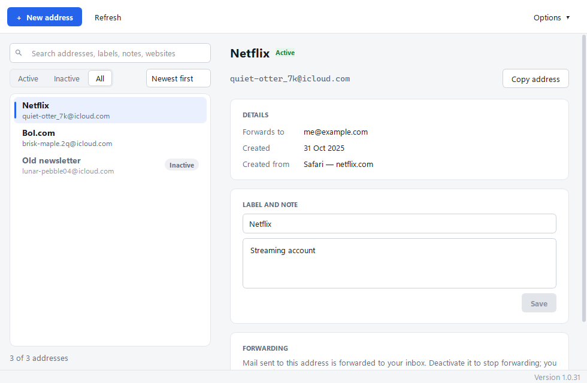
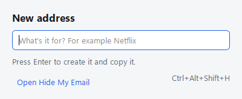
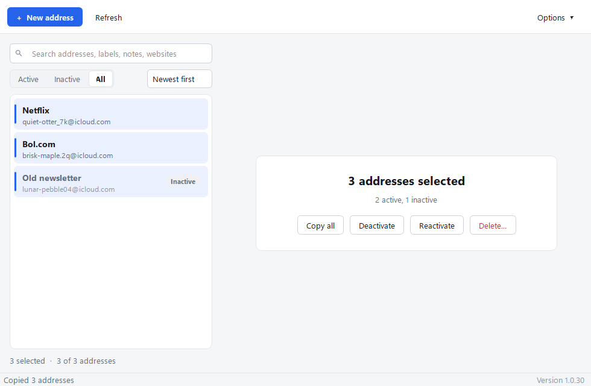
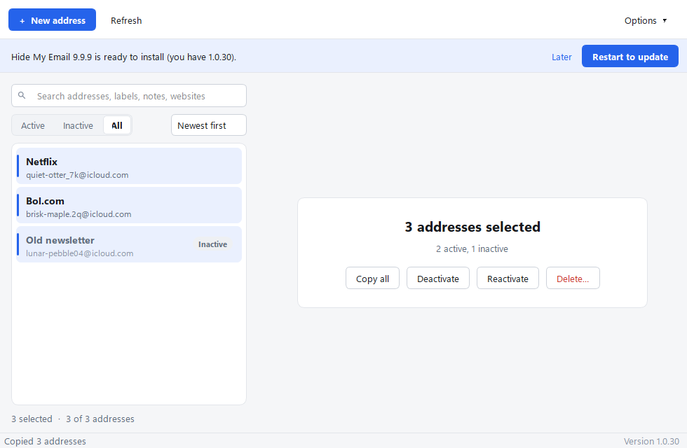

# Hide My Email

A desktop app for managing your iCloud+ **Hide My Email** addresses: the random `@icloud.com` addresses that forward to your real inbox. Create a new address in seconds, find the one you gave a website years ago, and switch off the ones that only bring spam.

Apple's own settings screen for Hide My Email is hidden deep in iCloud settings and has no search, sorting or bulk actions. This app adds them.

> Hide My Email is an independent app. It isn't made or endorsed by Apple. It uses the same private iCloud connection as icloud.com, because Apple doesn't offer an official one.

## What it does

- **See all your addresses** with their label, note, creation date, the inbox they forward to, and where they were made: in Safari for a website, by hand, or in an app.
- **Search** addresses, labels, notes and websites. Show active, inactive or all addresses, and **sort** by newest, oldest or name.
- **Create** a new address and copy it to the clipboard in one step.
- **Quick-create from anywhere** with a keyboard shortcut, without opening the main window.
- **Edit** the label and note.
- **Deactivate** an address to stop its mail (you can undo this), or **delete** it for good.
- **Select several addresses** and copy, deactivate, reactivate or delete them together.
- **Export** everything to a CSV file you can open in Excel or Numbers.
- Runs on **Windows** and **Mac**, and **updates itself**.

## Requirements

- An Apple ID with an **iCloud+** subscription. Hide My Email is part of iCloud+.
- **Two-factor authentication** on your Apple ID. This is on by default for almost all accounts.
- **Windows 10 or 11**, or a **Mac with Apple silicon** (M1 or later) running **macOS 14 Sonoma** or later. Intel Macs aren't supported.

## Install on Windows

1. Go to the [latest release](https://github.com/decentquintessential/hidemyemail/releases/latest) and download **HideMyEmail-Setup.exe**.
2. Your browser may warn you about the download, because the installer isn't signed with a paid certificate and few people have downloaded it yet. To keep it:
   - **Edge:** open Downloads (Ctrl+J), point at the file, click **…** → **Keep**. If you're asked again, click **Show more** → **Keep anyway**.
   - **Chrome:** open Downloads (Ctrl+J) and click **Keep**.
3. Open the installer. If Windows shows "Windows protected your PC", click **More info** → **Run anyway**.
4. Choose your options and click **Install**. You don't need admin rights: it installs only for your Windows user.
   - **Create a desktop shortcut:** optional.
   - **Start Hide My Email when I sign in to Windows:** useful together with the *Keep running in the tray* option (see [Quick-create from anywhere](#quick-create-from-anywhere)), so the shortcut always works.

Hide My Email then appears in the Start menu. To remove it, go to **Settings → Apps → Installed apps**.

> On a work computer, your organisation's security settings may block unsigned programs completely. If you see "Blocked by your organization", ask your IT department.

## Install on Mac

1. Go to the [latest release](https://github.com/decentquintessential/hidemyemail/releases/latest) and download **HideMyEmail-Mac.dmg**.
2. Open the downloaded file and drag **Hide My Email** onto the **Applications** folder.
3. Open Hide My Email from Applications or Launchpad. The first time, macOS says it can't verify the app, because it isn't signed with a paid Apple developer certificate. Click **Done** (not Move to Trash), then:
   - Open **System Settings → Privacy & Security** and scroll down to the message about Hide My Email.
   - Click **Open Anyway** and confirm with your Mac password or Touch ID.

   You only need to do this once.

After that, Hide My Email also appears as an envelope icon in the menu bar.

## Sign in

The first time you open the app, sign in with your **Apple ID and password**, then type the **6-digit code** that appears on your iPhone, iPad or Mac.

Your password is stored securely by your computer: in **Windows Credential Manager** on Windows, or the **Keychain** on a Mac. If your Mac asks whether **hme-helper** may use your Keychain, type the password you use to **log in to your Mac** (not your Apple ID password) and click **Always Allow**. hme-helper is the part of the app that talks to iCloud. After the first time, the app signs in on its own. Apple asks for a new code from time to time.

To sign out and remove the saved password, click **Sign out** in the toolbar on Windows, or **⋯ → Sign Out** on a Mac.

## Using the app

### Create an address

Click **New address** on Windows or **+** on a Mac (or press Ctrl+N or ⌘N). Type what it's for, for example "Netflix", and click **Create & Copy**. If you don't like the generated address, ask for another one first: click **Another one** on Windows, or the circular arrows on a Mac. The new address is copied to your clipboard, ready to paste into a sign-up form.

### Quick-create from anywhere

- **Windows:** press **Ctrl+Alt+Shift+H** in any program, or click the Hide My Email icon in the system tray (near the clock).
- **Mac:** press **⌃⌥⌘H** in any app, or click the envelope icon in the menu bar.

Type what the address is for and press **Enter** (Return on a Mac). The address is created and copied straight away.

The shortcut works while Hide My Email is open. Closing the main window **quits the app completely**: nothing keeps running in the background.

If you want the shortcut to work all the time, switch on **Options → Keep running in the tray when closed** on Windows, or **⋯ → Keep Running in Menu Bar When Closed** on a Mac. Closing the window then keeps the app in the tray or menu bar. To quit it completely, right-click the tray icon and choose **Quit** on Windows, or click the menu bar icon and choose **Quit** (or press ⌘Q) on a Mac.

### Find, sort and filter

- Type in the search box to search addresses, labels, notes and websites.
- Choose whether to show **Active**, **Inactive** or **All** addresses: with the menu under the search box on Windows, or the buttons at the top of the window on a Mac.
- **Sort** (above the list) orders the list by **Newest first**, **Oldest first**, **Name A–Z** or **Name Z–A**. "Name" is the label, and addresses without a label go at the bottom. The app remembers your choice.

### Edit, deactivate or delete

Select an address to see its details. From there you can:

- **Change the label or note** and click **Save**. iCloud doesn't allow edits to an inactive address, so reactivate it first.
- **Deactivate** it. Mail sent to it is no longer forwarded, but you keep the address and can **Reactivate** it later.
- **Delete** it. This is permanent: mail sent to it will bounce, and you can't get it back.

### Work with several addresses at once

Ctrl-click or Shift-click to select several addresses (⌘-click or ⇧-click on a Mac), or press Ctrl+A or ⌘A to select all of them. Then copy, deactivate, reactivate or delete them in one go, using the buttons on the right or by right-clicking the selection.

### Keyboard shortcuts

| Action | Windows | Mac |
|---|---|---|
| New address | Ctrl+N | ⌘N |
| Quick-create from any app | Ctrl+Alt+Shift+H | ⌃⌥⌘H |
| Copy the selected addresses | Ctrl+C | ⌘C |
| Deactivate or delete the selected addresses | Delete | Delete |
| Refresh the list | F5 | ⌘R |
| Select several addresses | Ctrl-click, Shift-click | ⌘-click, ⇧-click |

### Export

Click **Export CSV…** on Windows, or **⋯ → Export to CSV…** on a Mac, to save all your addresses, with their labels, notes, status and creation dates, as a spreadsheet file.

## Updates

The app checks for a new version shortly after it starts and every few hours. You can also check yourself: click **Check for updates** in the toolbar or tray menu on Windows, or choose **Hide My Email → Check for Updates…** (or **⋯ → Check for Updates…**) on a Mac. When a new version is available, the app downloads it in the background and shows a bar at the top of the window:

Click **Restart to update**. The app closes, installs the new version and opens again within a few seconds. On a Mac the bar also appears in the menu bar panel. If an update ever fails, the old version stays in place and opens again.

To see which version you have: on Windows it's shown at the bottom right of the window; on a Mac, choose **Hide My Email → About Hide My Email**. All versions are listed on the [releases page](https://github.com/decentquintessential/hidemyemail/releases).

## Good to know

- **Creation limits:** Apple limits how many addresses you can create in a short time. If creating fails, try again in an hour.
- **No "last used" date:** iCloud doesn't record when an address last received mail, so the app can't show it.
- **Forwarding address:** to change which inbox your addresses forward to, use your iPhone or Mac settings. The app shows the current forwarding address but can't change it.
- **Possible breakage:** because Apple has no official connection for Hide My Email, a change on Apple's side could stop the app working until it's updated.

## Privacy

- The app only talks to **Apple's iCloud servers**, to manage your addresses, and to **GitHub**, to check for updates. Nothing is sent anywhere else, and there's no tracking or analytics.
- Your password and iCloud session are stored only on your own computer.
- The code is public in this repository, so anyone can check what it does.

## How it's built

For those who are curious, or want to contribute:

- The iCloud connection uses the open-source [pyicloud](https://pypi.org/project/pyicloud/) library.
- The Windows app is written in Python with Qt ([PySide6](https://doc.qt.io/qtforpython-6/)) in [`windows/`](windows). The installer is made with [Inno Setup](https://jrsoftware.org/isinfo.php).
- The Mac app is written in SwiftUI in [`app/`](app). It uses the same iCloud code as the Windows app, through [`hme_helper.py`](hme_helper.py), which is packaged inside the app so nothing else needs to be installed.
- Every change is built and tested automatically on a Windows machine and a Mac by [GitHub Actions](.github/workflows/windows.yml). The tests install and open the apps, check the update process on both systems and take the screenshots on this page. A release is published only when both builds pass every check.
